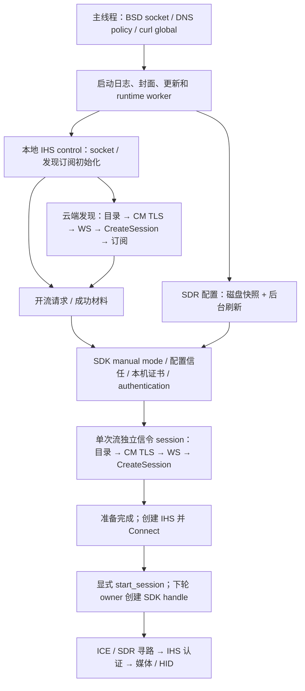

# 网络初始化、准入与资源所有权

本文规定应用初始化边界；Steam 线上协议仍以
[公网协议参考](STEAM_REMOTE_PLAY_NETWORKING.md)为准。请求调度和平台资源策略不冒充官方常量。

## 依赖图

封面、更新、云端订阅和配置刷新没有相互等待的业务依赖。本地发现不能等待其中任何一个
请求完成。runtime 每次循环都推进控制、准备和已启动的传输；不靠跳过一次 update 保证顺序。
DNS 工作线程只发布拥有的结果，不操作 CURL、IHS 或 UI。

runtime的`ensure_control`统一首次启动与显式命令重试：本地client/socket及发现订阅
成功后，才构造发现CM owner；本地失败保留空client，不继续构造CM，不增加自动重试
计时器。上述依赖只是本地资源初始化，不等待任何局域网发现回复、DNS或云端请求。
已有client时复用owner，不因普通命令重复创建CM。来源为原BStart的本地失败分支及
完整runtime worker对照，见D-A107、协议参考§185。root curl失败时仍允许本地client运行，
保持下文D-A105的独立HTTP失败语义。

## 准备与连接是两个边界

- `sl_sns_initialized`：配置导入、可选证书安装和 authentication 已完成，对应原 BInit 边界。
- `sl_sns_session_ready`：上述条件成立，且本次流的独立信令 session 至少成功建立过一次。
- `sl_sns_start_session`：调用者已经创建 IHS 并调用 Connect，明确允许下一轮 SDK 建连。

**官方证据**：`CStreamClient::BConnect @0x7a7808` 在 BInit 后创建 bridge/Connection；
后续 UpdateState 才创建 SDK handle。官方 SDL 的十秒初始 Connecting 期限包含 bridge 和 SDK
寻路，见协议参考 §12.2、§126。不能将官方 BInit 本身解释为已经连通 CM。

**本项目行为差异**：多地址 HTTPS 兼容层可能需要较长的目录/TLS 尝试，因此应用先完成独立
信令 session，再开始 IHS 十秒连接期限。准备阶段从首次 owner update 起最多九十秒，包含配置
获取及其重试、目录、CM TLS、WS 和 CreateSession，不因阶段切换或重试重置。SDK 自身的
TimeoutInitial=20000ms、IHS 十秒期限及所有线上包格式保持各自含义。准备完成不等于媒体可用，
此后仍必须完成真实 ICE/SDR/IHS 认证。

该门槛只决定首次准入：媒体开始后 CM 断开仍按桥接重连/FIFO 规则处理，不能重新关闭准入、
重复创建 IHS 或重启初始计时。发现 manager 的 session 与流信令 session 始终独立；不借用
manager session_id，不复用其他流的密钥。取消准备不会创建 IHS 或 SDK 连接句柄。

## DNS 与 TLS 调度

DNS 固定公共提供器、每提供器 wire 预算、全局并发和限速见 D-A102。新增的共享范围只包括
**尚在进行的同域名查询**：每个请求持有订阅，各自保存候选游标、HTTPS 总期限和 CURL handle。
取消一个订阅不取消其他订阅；最后一个订阅负责 stop → join → free。已经完成的查询不供新
请求作为历史缓存使用；没有成功 IP 提示、CM 地址缓存或跨进程地址复用。

目录 GET 和 WebSocket 前的 TLS 握手使用 `http_bootstrap`：

1. 一个 DNS 计划，首答立即尝试；迟到地址继续补充，所有尝试共享唯一候选游标。
2. 停滞时每隔 250ms 增开一个候选，最多三个活跃 TCP/TLS；每个候选最多四秒连接预算，
   全部候选共享同一个九十秒总期限。仍按 /24 轮换，保留同段后备，不永久拉黑地址。
3. 每个候选有独立响应缓冲和 RESOLVE 列表。首个完整完成的响应胜出，取消/关闭其余候选；
   若先观察到 HTTP 头、正文尚未完成，则立即锁定该响应并关闭其他候选，不再增开尝试。
   HTTP 错误和半截正文也结束本次请求，不能合并正文或把错误当作可重放的业务事务。
4. TLS 胜者保持原 multi 归属，交接给 WebSocket 层；TLS/SNI/主机名验证保持开启。

并行仅用于上述幂等引导请求；配对、开流、控制、信令和输入报文不使用它。封面、更新和配置
请求仍沿各自原有 owner 与完成语义。桌面普通构建保留单候选连接；受控测试显式编译 Switch
调度分支，不能拿桌面系统 resolver 的成功代替该分支的验证。

## 生命周期

| 资源 | 所有者 | 发布条件 | 释放条件 |
|---|---|---|---|
| BSD / DNS policy | 平台主线程 | socket 初始化完成 | 所有网络 owner/worker 停止后 |
| curl 全局状态 | 加锁引用管理；应用主线程持根引用 | 第一个引用成功初始化 | 最后一个引用释放；所有借用 handle/线程已清理 |
| DNS 工作 | 在途查询对象；HTTP owner 各持订阅 | 验证后的累积地址快照 | 最后订阅取消并 join |
| 发现client / UDP | runtime actor | socket及发现订阅初始化成功 | 停任务、停止client、join其拥有的线程并销毁，先于CM销毁 |
| 发现CM owner | runtime actor | 本地client初始化成功；对象构造不等于网络可用 | control生产者停止后，先关闭HTTP/WS，再释放连接 |
| 目录/CM 候选 | bootstrap owner | 候选先配置、再加入 multi | 败者先 remove/cleanup，后释放 RESOLVE |
| TLS 胜者 | remote connection | 从 bootstrap 移交 handle/route/body | WebSocket 清理后销毁 easy，再释放 route |
| 启动配置快照 | runtime 配置缓存 | 完整下载成功或磁盘读取成功 | runtime 退出；单次流只消费副本 |
| SDK / bridge / 临时材料 | 单次流 SNS owner | 配置、证书、bridge 各自成功 | IHS 中断/join 后，关闭 SDK、清理 HTTP/bridge、Kill SDK |
| IHS session | runtime actor | 准备完成 | Disconnect → join → destroy，先于 backend 释放 |

应用在启动任何 worker 前尝试取得 curl 根引用；失败时保留 UI/局域网 runtime，
由各 HTTP owner 单独报告不可用，不能把 HTTPS 变成本地发现的启动前提。封面、更新、发现、配置和 SNS 还持自己的引用，
使独立探针和部分创建失败也有完整依赖。SDK-style 配置下载不再假设发现模块已经初始化 curl。
网络文件的发布复用 `file_replace`；Horizon 目标已存在时采用可恢复 `.old` 替换，
配置加载恢复缺失的主文件，避免每次重新启动仍读取未更新的旧快照，见 D-A106。
准备取消、工厂失败、DNS 失败和媒体失败都经过相同 owner 的清理路径，不创建 detached worker。
辅助 UDP 小缓冲纪律仍见 D-A103；TCP/TLS 并发的真机资源余量必须由实际设备结果判断。

## 审计证据与边界

`4eb9804` 热点记录 `session-00000000001792745188-089033100-00000.log` 中：
首个目录 TLS 尝试在启动约 0.85 秒，目录成功约 39.98 秒，主机在线约 43.58 秒。九个候选各
接近四秒失败，第十个成功；DNS 首答不是这段延迟的主要耗时。单次流随后证书安装、配置导入和
SDK 创建均成功，没有该次的 ENOBUFS；其独立目录请求重走冷启动，约 IHS 第 9.5 秒才开始 CM
TLS，约第十秒被播放器结束。这支持“准备预算与 IHS 期限冲突”，不证明没有其他网络故障。

未知的公网链路、MTU 和丢包原因仍是待验证；不能用 ping 成功推断 TLS 可用，也不能用
IHS datagram 计数为零推断没有 SDK/STUN/SDR 原始探测包。项目内的本地夹具验证准入顺序、
候选隔离、取消/join 和持有关系，不证明 Steam 主机在任意长准备期间始终保留同一票据，亦不
证明真实热点/SDR或 Switch loader 已通过。完整设备结果及工作状态只记录到 GitHub Issues。
